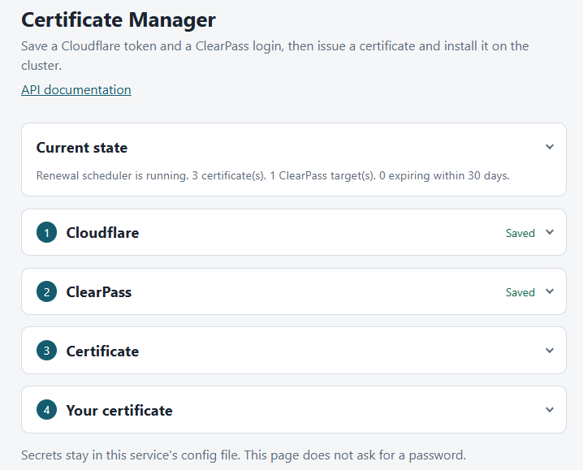
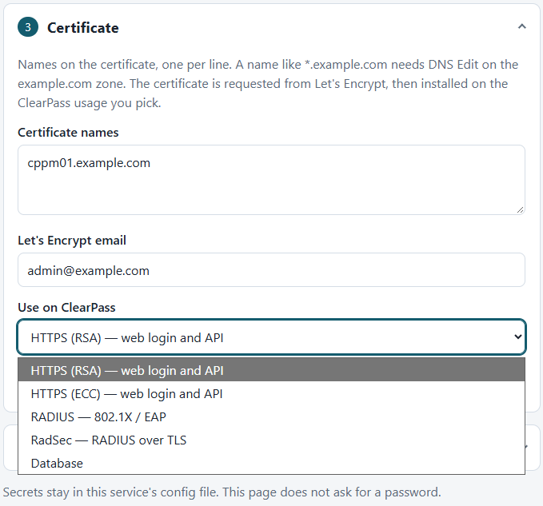

# Certificate Manager

An unofficial fork of [nowireless4u/cert-manager](https://github.com/nowireless4u/cert-manager).

One FastAPI service issues Let's Encrypt certificates with Certbot and can install them on an Aruba ClearPass cluster. The REST API is the control plane. An optional setup page in the same process calls that API. The page is not required. Anything the page can do, a script can do by calling the API directly.

## Architecture

The container runs one process. It serves the API, the optional page, and the certificate download ClearPass uses.

```
browser or script
        |
        |  HTTP :8000  (and :80, the same process)
        v
+--------------------------------------------------+
| FastAPI                                          |
|   GET /            optional setup page           |
|   /api/...         credentials, certs, deploy    |
|   /download/...    one-time PFX fetch            |
|   background       renewal loop + health monitor |
+--------------------------------------------------+
        |                         |
        | certbot                 | ClearPass REST
        v                         v
Let's Encrypt              cluster publisher
(DNS plugin edits          (node GETs the PFX
 the TXT record)            from this service)
```

**Issuance.** A certificate request runs `certbot certonly`. The DNS plugin creates the `_acme-challenge` TXT record and deletes it afterward. This service does not call the DNS provider's API itself. Installed DNS plugins are Cloudflare, Route 53, and DigitalOcean. Google Cloud DNS, OVH, and DuckDNS are named in the provider list, and their Certbot plugins are not installed. HTTP-01 standalone and webroot are available. The nginx and apache plugins are not installed. HTTP-01 cannot issue a wildcard.

A renewal is a new issuance. The service removes the old Certbot lineage for that name and requests the certificate again.

Certificates with `is_edge: false` are stored under `data/certs/`. That is the usual ClearPass path. Certificates with `is_edge: true` are stored under `ssl/live/` for an nginx edge server.

**ClearPass install.** Deploy does not upload the certificate in the API body. It tells each node to download `http://EDGE_DOMAIN/download/<token>/clearpass.pfx` on port 80. `EDGE_DOMAIN` is the hostname or IP address of the machine running this service, the address ClearPass can open. It is set in `.env`. The certificate name and the ClearPass hostname belong in `EDGE_DOMAIN` only when they also point at this host. Docker Compose publishes port 80 and port 8000 to the same process. The process listens on 8000. Docker accepts port 80 and forwards it.

The publisher's cluster API supplies the node list, and the certificate is installed on each of those servers. `additional_nodes` are further hostnames contacted directly. A usual cluster is the publisher plus one or more subscribers. The setup page stores those subscriber hostnames with the ClearPass login.

**Setup page.** `GET /` returns one HTML file. There is no separate frontend build. The page saves a Cloudflare token, saves a ClearPass API client, issues a certificate, and installs it by calling `/api`. Current state lists saved certificates and can deploy one of them again. The API keeps working with the page closed.

**Background work.** Two loops run inside the process. Once a day (00:30 UTC by default) the renewal loop reissues ACME certificates inside the renewal window and deploys them to services that use them. Every five minutes the monitor compares the certificate on each service with the copy stored here and deploys again when the serial numbers differ. It also retries a certificate request that is still pending or failed, up to five times.

Credential tests, certificate jobs, and deploy results are all API operations. Jobs are kept in memory and are dropped when the process restarts. Saved certificates and `data/config.yaml` remain.

There is no API password. Do not publish port 80 or port 8000 on an untrusted network.

## Quick start

### Docker Compose

```bash
cd cert-manager
cp .env.example .env
```

Set `EDGE_DOMAIN` in `.env` to the hostname or IP of this Docker host. Every ClearPass node must be able to open port 80 on that address.

```bash
docker compose up -d
```

| Port | What answers |
|------|----------------|
| 8000 | Setup page, API, and interactive docs |
| 80 | The same process. ClearPass downloads the certificate here |

The setup page is optional:

- http://localhost:8000/
- API docs: http://localhost:8000/docs

```bash
docker compose logs -f
```

The page is copied into the image. After a page change, rebuild:

```bash
docker compose up -d --build
```

### Local development

```bash
python -m venv venv
source venv/bin/activate
pip install -e ".[dev]"
uvicorn cert_manager.app:app --reload --host 0.0.0.0 --port 8000
```

This listens on port 8000 only. ClearPass still needs port 80 of `EDGE_DOMAIN` to reach `/download`. Compose is what publishes that port.

## Setup page

Open http://localhost:8000/. The page is one file served by this service. It is a client of the API below. Skip it and call the API when you want to.

The cards start collapsed. Current state is the renewal line: whether the scheduler is running, how many certificates are saved, and how many expire within 30 days. It does not name the next check or say which certificates Let's Encrypt will replace.



The Certificate card is a Let's Encrypt request. The usage list is where that certificate is installed on ClearPass.



The page has these cards:

1. **Current state.** Saved certificates, the ClearPass target each one is assigned to, and a Deploy button that installs that saved certificate again. The card also shows the download address from `EDGE_DOMAIN`.
2. **Cloudflare.** Create an API token in Cloudflare with Zone DNS Edit and Zone Zone Read on the zone that owns the name. Paste the token here. This is not the Global API Key.
3. **ClearPass.** Create the API client in ClearPass first (Administration, API Services, API Clients). Operating mode is ClearPass REST API, grant type is Client credentials, and the operator profile must be allowed to manage server certificates and the trust list. Test login reads the DNS name currently installed for HTTPS (RSA), HTTPS (ECC), RADIUS / EAP, RadSec, and Database.
4. **Certificate.** Names on the certificate, the Let's Encrypt account email, and the ClearPass usage. Issue and install requests a certificate and then deploys it. Deploy on a saved certificate does not request a new one.
5. **Your certificate.** Paste a PEM chain and private key you already have. Save and install stores that pack as a manual certificate and deploys it. Let's Encrypt is not contacted, and the daily job does not renew it.

The ClearPass API client cannot be created from this page. The client secret is shown once inside ClearPass.

## Configuration

### Environment variables

| Variable | Default | Description |
|----------|---------|-------------|
| `EDGE_DOMAIN` | `localhost` | Hostname or IP ClearPass uses to download a certificate on port 80. It must reach this host. Also the directory name for edge certificates under `ssl/live/` |
| `DATA_DIR` | `/app/data` | Config, certificate packs, and logs |
| `SSL_DIR` | `/etc/letsencrypt` | Certbot directory |
| `LOG_LEVEL` | `INFO` | `DEBUG`, `INFO`, `WARNING`, or `ERROR` |
| `SCHEDULER_ENABLED` | `true` | Run the renewal and health loops |
| `SCHEDULER_TIME` | `00:30` | Daily renewal time, UTC, `HH:MM` |
| `NGINX_CONTAINER_NAME` | `nginx` | Container signaled after an edge certificate changes |

### Files

```
cert-manager/
├── data/
│   ├── config.yaml          # Credentials, services, and certificate metadata
│   ├── certs/               # Certificate packs installed on ClearPass
│   ├── logs/
│   └── backups/
└── ssl/
    └── live/                # Edge certificates, when is_edge is true
        └── {domain}/
            ├── fullchain.pem
            └── privkey.pem
```

`data/config.yaml` and `ssl/` hold secrets and private keys. They are gitignored.

## API

Interactive docs:

- Swagger UI: http://localhost:8000/docs
- ReDoc: http://localhost:8000/redoc

Longer notes are in [docs/API_REFERENCE.md](docs/API_REFERENCE.md).

| Method | Endpoint | Description |
|--------|----------|-------------|
| GET | `/api/health` | Health, counts, and `callback_base` (`http://EDGE_DOMAIN`) |
| GET | `/api/certs` | List certificate packs |
| POST | `/api/certs/request` | Request a certificate and wait until Certbot finishes |
| POST | `/api/certs/jobs` | Start a request and return a job id |
| GET | `/api/certs/jobs` | List in-memory jobs |
| GET | `/api/certs/jobs/{job_id}` | Job status and Certbot output |
| POST | `/api/certs/{name}/jobs` | Start a renewal job |
| POST | `/api/certs/{name}/renew` | Renew and wait until Certbot finishes |
| POST | `/api/certs/upload` | Upload a certificate and key |
| DELETE | `/api/certs/{name}` | Delete a certificate pack |
| GET | `/api/services` | List ClearPass targets |
| POST | `/api/services` | Add a target |
| PATCH | `/api/services/{name}` | Change the host, usage, or certificate pack |
| POST | `/api/services/{name}/deploy` | Install the target's certificate pack |
| GET | `/api/services/{name}/health` | Compare the stored certificate with the one on ClearPass |
| GET | `/api/credentials/acme` | List ACME credentials. Secrets are omitted |
| POST | `/api/credentials/acme` | Save an ACME credential |
| POST | `/api/credentials/acme/test` | Check a Cloudflare token without saving it |
| POST | `/api/credentials/acme/{id}/test` | Check a saved Cloudflare credential |
| GET | `/api/credentials/clearpass` | List ClearPass logins. Secrets are omitted |
| POST | `/api/credentials/clearpass` | Save a ClearPass login |
| POST | `/api/credentials/clearpass/test` | Log in and read installed certificate names |
| POST | `/api/credentials/clearpass/{id}/test` | Same check for a saved login |
| GET | `/api/settings` | Scheduler settings stored in the config file |
| PATCH | `/api/settings` | Update those settings |

The setup page uses the job and credential-test routes. The blocking request and renew routes are still there for scripts.

### Examples

Save a Cloudflare token. The token needs Zone DNS Edit and Zone Zone Read. The Let's Encrypt account email is the `email` field on the certificate request, not this credential.

```bash
curl -X POST http://localhost:8000/api/credentials/acme \
  -H "Content-Type: application/json" \
  -d '{
    "id": "cloudflare-main",
    "name": "Cloudflare DNS",
    "provider": "cloudflare",
    "api_token": "your-cloudflare-api-token"
  }'
```

Request a certificate and wait. Use `"is_edge": false` for a certificate that will be installed on ClearPass.

```bash
curl -X POST http://localhost:8000/api/certs/request \
  -H "Content-Type: application/json" \
  -d '{
    "pack_name": "clearpass.example.com",
    "domains": ["clearpass.example.com"],
    "provider": "cloudflare",
    "credential_id": "cloudflare-main",
    "email": "admin@example.com",
    "challenge_type": "dns-01",
    "key_type": "rsa",
    "is_edge": false
  }'
```

`HTTPS(ECC)` uses `"key_type": "ecdsa"`. The other ClearPass usages use `rsa`.

Save the ClearPass API client created inside ClearPass:

```bash
curl -X POST http://localhost:8000/api/credentials/clearpass \
  -H "Content-Type: application/json" \
  -d '{
    "id": "cppm-prod",
    "name": "Production ClearPass",
    "host": "clearpass.example.com",
    "client_id": "your-oauth-client-id",
    "client_secret": "your-oauth-client-secret",
    "verify_ssl": false
  }'
```

Point a target at the saved pack and install it. Deploy reads `EDGE_DOMAIN` from the environment of the running process, so recreate the container after changing `.env`.

```bash
curl -X POST http://localhost:8000/api/services \
  -H "Content-Type: application/json" \
  -d '{
    "name": "clearpass-https-rsa",
    "host": "clearpass.example.com",
    "type": "clearpass",
    "cert_pack_id": "clearpass.example.com",
    "cert_usage": "HTTPS(RSA)",
    "credential_id": "cppm-prod",
    "enabled": true,
    "additional_nodes": ["cppm-node2.example.com"]
  }'

curl -X POST http://localhost:8000/api/services/clearpass-https-rsa/deploy
```

A failed install leaves the certificate on disk. Call deploy again after `EDGE_DOMAIN` is reachable. That does not ask Let's Encrypt for another certificate.

## ClearPass

| Usage | What it is |
|-------|------------|
| `HTTPS(RSA)` | Web login and API, RSA key |
| `HTTPS(ECC)` | Web login and API, ECDSA key |
| `RADIUS` | RADIUS / EAP |
| `RadSec` | RADIUS over TLS |
| `Database` | Database server certificate |

On a successful login test, the API returns the DNS name on each of those certificates for every node in the cluster. A usage with no certificate is an empty name list and the login still succeeds.

Deploy installs the pack on the nodes returned by the publisher cluster API, then repeats that install on each hostname in `additional_nodes`. Put the publisher in `host` and the subscribers in `additional_nodes`. The setup page field "Other cluster nodes" is that list. CA certificates from the chain are added to the trust list when they are missing. A CA trust failure is reported in the deploy message and does not by itself undo an install that succeeded.

A certificate you already have is `POST /api/certs/upload` with PEM `fullchain` and `privkey`. The pack is `manual`, `auto_renew` stays off, and deploy installs it on the same cluster. The private key must match the first certificate in the chain and must not be encrypted.

## Nginx

Renewing a certificate with `is_edge: true` sends SIGHUP to the container named by `NGINX_CONTAINER_NAME`. That needs `/var/run/docker.sock` mounted into this container. The certificate files for that mode are under `ssl/live/{EDGE_DOMAIN}/`.

ClearPass certificates do not use this path.

## Background scheduler

The setup page reports that the scheduler is running. It does not show a per-certificate renewal time. Two loops run after a certificate is installed.

**Renewal, daily.** Runs at `SCHEDULER_TIME` (default 00:30 UTC). Reissues Let's Encrypt packs with `auto_renew: true` that expire within 30 days, then deploys the new certificate to services that use it. Reloads nginx for edge packs. A certificate uploaded on Your certificate is `manual` and `auto_renew: false`, so this loop leaves it alone.

**Monitor, every 5 minutes.** Reads the certificate on each enabled ClearPass target, including subscriber hostnames. When the serial on the appliance does not match the copy stored here, it installs that stored copy again. This is the same file, not a new certificate from a certificate authority. It also retries a Let's Encrypt request that is still pending or failed, up to five times.

## Security

Credentials are plaintext in `data/config.yaml`. The API does not ask for a password. Port 80 and port 8000 serve that API, including the certificate download.

Keep `config.yaml` out of git, restrict its permissions, and publish the service only on a network that should be able to manage certificates. ClearPass API calls use `verify_ssl: false` unless you set it true on the credential.

## Troubleshooting

```bash
docker compose logs -f cert-manager
```

Application log: `data/logs/cert-manager.log`. Certbot log: `ssl/logs/letsencrypt.log`.

ClearPass returns `Cert File is empty or invalid post body` when it cannot fetch a real PFX from `http://EDGE_DOMAIN/download/...` on port 80. Set `EDGE_DOMAIN` to this host, publish port 80, confirm each node can open that address, recreate the container, and deploy the saved certificate again.

A second Issue and install for the same name asks Let's Encrypt for another certificate. Deploy the pack that is already stored when the install is the step that failed.

```bash
LOG_LEVEL=DEBUG docker compose up
```

## License

MIT License.
